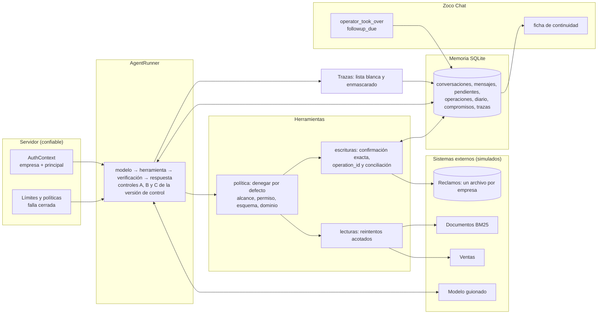

# Zoco Cortex: harness de agentes

Un motor pequeño para correr agentes con permisos, memoria, control humano y seguimiento
comercial, con cada empresa completamente separada de las demás. Es la segunda prueba técnica de
Zoco y reutiliza los componentes de la primera (ventas, reclamos, buscador, contratos de fechas).

El comando que lo prueba todo, sin claves ni internet: `make eval`.

## Empezá acá

| Querés ver... | Mirá |
|---|---|
| El motor: modelo, herramienta, verificación, respuesta | `src/cortex/runner/agent_runner.py` |
| Cómo se rechaza lo que no está permitido | `src/cortex/tools/policy.py` |
| Cómo una escritura no se duplica | `src/cortex/tools/writes.py` |
| Cómo se aíslan las empresas | `src/cortex/memory/tenant_store.py` |
| Cómo se comprueba que todo funciona | `evaluation/harness/checker.py` |
| Qué dice la consigna, qué es trampa y qué decidí | [REVISION_CONSIGNA.md](REVISION_CONSIGNA.md) |
| Por qué está hecho así, y el caso de Zoco Canchas | [DESIGN_DECISIONS.md](DESIGN_DECISIONS.md) |
| Amenazas, controles, lo que no se agregó y los riesgos que quedan | [SEGURIDAD.md](SEGURIDAD.md) |

## Instalación y uso

Requisitos: Python 3.11 o superior, [uv](https://docs.astral.sh/uv/), `make` y un shell POSIX.

```bash
make setup    # dependencias desde uv.lock
make eval     # los 13 escenarios del kit y las variantes propias, contra el estado real
make demo     # cinco escenarios (lectura, otra empresa, escritura, toma de control, seguimiento)
make check    # lint, tipos estrictos, contratos de arquitectura y tests
uv run python evaluation_adapter.py --scenario examples/T02.json --output resultado.json
```

Tras `make setup`, el comando literal del contrato funciona con `python` o con `python3`
(`python3 evaluation_adapter.py ...`): si ese Python no tiene el harness, el adaptador se relanza
con el `.venv` del proyecto.

El modelo es un guion determinista (el `model_script` de cada escenario), así que nada necesita
internet ni claves. El historial que recibe el modelo se limita a 12 mensajes (de
`harness_config.json`) y, si contiene algún mensaje del usuario, la ventana empieza en el primero.
Aparte del historial se envían estructurados, nunca resumidos, el modo de la conversación, la
versión de control, las acciones pendientes y los compromisos. El `.env.example` abre con un
comentario que dice que el harness solo lee `CORTEX_TRACE_KEY` (opcional); el resto son los ajustes
de la primera entrega, que el harness no usa. `CORTEX_TRACE_KEY` la lee solo el punto de entrada,
nunca la librería.
**No incluye la demostración con un LLM real** (IT no facilitó acceso): el modelo entra por el
puerto de `src/cortex/runner/model.py`, que es donde se enchufaría.

## Cómo funciona



- **El modelo propone, el código dispone.** Una solicitud de herramienta pasa por una cadena que
  deniega por defecto; un rechazo nunca llega al adaptador de la herramienta.
- **La empresa viene del servidor.** Ningún argumento del modelo ni texto del usuario la elige, y
  ningún método de memoria recibe el id de empresa: se construye desde el contexto autenticado.
- **Una escritura se ejecuta una vez.** Pide la confirmación exacta de sus valores y queda
  registrada por (empresa, `operation_id`) antes de llamar al sistema externo.
- **La versión de control se mira tres veces** (antes del modelo, antes de ejecutar y al entregar):
  una respuesta generada antes de que una persona tome el control no se envía.

## La consigna, punto por punto

| Sección | Dónde | Cómo se prueba |
|---|---|---|
| 2. Motor y límites | `src/cortex/runner/`, `src/cortex/config.py` | `tests/cortex/integration/test_kit_scenarios.py::test_t08_the_scenario_step_limit_overrides_the_default`, `tests/cortex/integration/test_runner_guards.py::test_a_model_slower_than_the_time_left_ends_the_run_at_its_total_time`, `tests/cortex/unit/test_timeouts.py::test_a_slow_read_is_abandoned_as_a_transient_failure` |
| 2. Sin estado global y aislamiento de ejecuciones | todo `src/cortex/`; el candado por conversación en `src/cortex/memory/runs.py` | `tests/cortex/unit/test_harness_invariants.py::test_no_module_holds_mutable_global_state`, `tests/cortex/integration/test_runner_guards.py::test_a_second_run_on_a_busy_conversation_is_refused_without_calling_the_model` |
| 3. Permisos y alcance | `src/cortex/tools/policy.py`, `src/cortex/identity.py` | `tests/cortex/integration/test_tenancy.py::test_claiming_to_be_an_administrator_does_not_open_another_company` |
| 3. Confirmación exacta | `src/cortex/tools/confirmation.py` | `tests/cortex/integration/test_writes.py::test_changed_values_after_a_confirmation_need_a_new_one` |
| 4. Persistencia y reinicio | `src/cortex/memory/` | `tests/cortex/integration/test_chat.py::test_three_separate_processes_file_one_claim` |
| 4. Historial acotado | `src/cortex/runner/agent_runner.py` | `tests/cortex/integration/test_runner.py::test_the_history_sent_to_the_model_is_bounded_but_critical_state_is_not_summarized` |
| 4. Dos empresas, mismo nombre | `src/cortex/memory/tenant_store.py` | `tests/cortex/integration/test_tenancy.py::test_t06_interleaved_conversations_of_two_companies_stay_separated` |
| 5. Reintentos y fallas | `src/cortex/tools/retry.py`, `src/cortex/tools/failures.py` | `tests/cortex/integration/test_failures.py::test_t07_a_transient_read_failure_is_retried_once_and_counted_once` |
| 5. Escritura incierta | `src/cortex/tools/writes.py` | `tests/cortex/integration/test_writes.py::test_a_write_committed_before_a_timeout_is_reconciled_not_repeated` |
| 6. Toma de control | `src/cortex/memory/chat_records.py` (compare-and-set por versión) y `src/cortex/chat/service.py` (la aplica) | `tests/cortex/integration/test_chat.py::test_t11_a_reply_generated_before_the_takeover_is_never_delivered`, `tests/cortex/integration/test_chat.py::test_a_takeover_before_delivery_is_applied_whatever_the_run_delivers` |
| 6. Seguimiento | `src/cortex/chat/followup.py` | `tests/cortex/unit/test_followup.py::test_each_case_of_the_kit` |
| 7. Trazas sin secretos | `src/cortex/observability/` | `tests/cortex/integration/test_traces.py::test_no_secret_reaches_a_trace_a_result_a_log_or_the_operators_card` |
| 7. Evaluación sobre estado real | `evaluation/harness/` | `tests/cortex/integration/test_eval_suite.py::test_an_adapter_that_reports_a_message_that_was_not_sent_is_caught` |
| 8. Caso de diseño (Zoco Canchas) | [DESIGN_DECISIONS.md](DESIGN_DECISIONS.md) | `tests/cortex/unit/test_design_decisions.py::test_the_canchas_case_fits_in_one_page`, `tests/cortex/unit/test_design_decisions.py::test_it_answers_each_point_the_brief_asks_for` |
| 9. Entregables y documentación | este README (diagrama, resultados y limitaciones), `evaluation_adapter.py`, `.env.example`, `kit/fixtures`, `evaluation/results/harness/`, [SEGURIDAD.md](SEGURIDAD.md) | `tests/cortex/integration/test_entry_point.py::test_the_literal_command_works_with_the_system_python_from_another_directory`, `tests/unit/test_docs_consistency.py::test_every_test_function_the_document_cites_exists` |

## Las tres condiciones críticas

La consigna descarta una entrega que permita alguna de estas tres cosas.

| Condición | Cómo se impide | Prueba |
|---|---|---|
| Acceso entre empresas | La empresa sale del contexto autenticado; los repositorios están atados a ella; cada consulta SQL filtra por empresa | `tests/cortex/integration/test_tenancy.py::test_every_query_on_company_data_filters_by_company` |
| Herramienta o escritura no autorizada | Cadena que deniega por defecto; las escrituras exigen confirmación exacta | `tests/cortex/unit/test_policy.py::test_naming_a_company_or_a_role_is_a_scope_violation_that_ends_the_run`, `tests/cortex/integration/test_kit_scenarios.py::test_t03_an_unknown_tool_is_rejected_without_any_external_call`, `tests/cortex/unit/test_policy.py::test_a_principal_without_the_permission_is_denied`, `tests/cortex/integration/test_writes.py::test_without_a_confirmation_nothing_is_written_and_the_user_is_asked` |
| Escritura duplicada al reintentar | Registro por (empresa, `operation_id`), clave única en el sistema de reclamos y conciliación antes de reintentar | `tests/cortex/integration/test_writes.py::test_concurrent_executions_of_one_command_have_one_effect` |

## Resultados y trazas

- Resultados fechados: `evaluation/results/harness/2026-10-30/report.md`. Registran el commit del
  código que corrió; el último commit del repositorio solo agrega esos resultados.
- Dos trazas anonimizadas, un éxito y un fallo: `evaluation/results/harness/traces/`
  (se regeneran con `uv run python -m cortex.kit_adapter.samples`). El éxito es T07 del kit. El
  fallo es T09 con dos TIMEOUT inyectados en la escritura: queda incierta y la búsqueda no
  encuentra nada. No es un escenario del kit tal cual.
- Las marcas de tiempo de las trazas son el reloj fijo de la evaluación (`2026-10-28T12:00:00Z`) y
  `elapsed_ms` es tiempo simulado (un temporizador manual que solo avanza con los timeouts y
  esperas simuladas), así que las trazas se reproducen igual en cada corrida.
- El verificador no importa el harness: relee los archivos SQLite en solo lectura y recalcula
  mensajes enviados, reclamos, filas de otra empresa, modo, trazas, herramientas ejecutadas y
  rechazadas, reintentos, pasos, decisión de seguimiento, acciones pendientes y estado tras el
  reinicio, separación de conversaciones y límite de pasos. Lo único que no puede recalcular es
  `external_calls_to_rejected_tool`, que se cuenta en el borde de la herramienta y no se guarda.

## Revisión adversarial

Antes de entregar, dos revisores ciegos e independientes (dos agentes con el mismo encargo, sin
ver el trabajo del otro) buscaron formas de violar las tres condiciones críticas. Coincidieron en
un defecto crítico: una escritura con resultado incierto se volvía a enviar sin revisar la
confirmación, así que después de una toma de control podía crear un reclamo que nadie había
confirmado de nuevo. También coincidieron en cinco advertencias: carreras entre el control y la
escritura, una operación que podía quedar trabada, un reintento tras un crash que podía repetir
una respuesta, la ficha del operador y un código de salida. Todo se corrigió, y cada hallazgo
tiene un test que falla con el código revisado y pasa ahora:
`tests/cortex/integration/test_review_findings.py`.

Una segunda pasada no encontró ningún defecto crítico. También se corrigieron sus cinco hallazgos
menores (un `run_id` derivado que desbordaba el largo permitido, una conversación ajena que podía
conciliar un comando incierto, una confirmación ya usada que se reutilizaba tras un fallo, la
repetición de un seguimiento con otra conversación o carrera, y un valor que podía imitar otro
campo en la pregunta de confirmación), con sus tests en el mismo archivo.

La revisión final tampoco encontró defectos críticos. Se corrigieron sus advertencias y
sugerencias: una confirmación que seguía vigente si su escritura se rechazaba antes de intentarse,
una toma de control rechazada que no dejaba `tool_rejected` en la traza, lo pendiente de una
oportunidad que se cancelaba con la decisión de otra, el evento de fallo sintético y sus
contadores, un texto que UTF-8 no puede codificar, el responsable sin enmascarar en la ficha y
rutas equivocadas en `SEGURIDAD.md`.

## Limitaciones pendientes

- **Sin demostración con LLM real** (ver arriba).
- **Los hilos abandonados por un timeout no se pueden matar** (Python no lo permite): ni el de una
  herramienta ni el de la llamada al modelo, que se abandonan en su límite pero pueden terminar en
  segundo plano. Por eso todo timeout de una escritura se trata como
  incierto y se verifica por su `operation_id`; una lectura abandonada se descarta.
- **Un comando interrumpido por un crash no se vuelve a ejecutar con el mismo `run_id`** (podría
  haber respondido antes de caerse): termina `FAILED` con `run_interrupted` y se reintenta con un
  `run_id` nuevo. Una escritura que quedó en vuelo se concilia por su `operation_id`.
- **Sin migraciones de esquema.** Cada mundo se crea con el esquema vigente. Por eso `--workdir`
  debe estar vacío o no existir: uno con contenido se rechaza (código de salida 2) en lugar de
  reutilizarse.
- **Autenticación simulada.** El principal y la empresa son fixtures confiables del evaluador;
  no hay login, emisión ni vencimiento de credenciales.
- **Un solo proceso y SQLite local.** Los candados (una ejecución por conversación, escrituras con
  `BEGIN IMMEDIATE`) están probados con hilos y con procesos secuenciales, no con varios servidores
  (el de la conversación, en `tests/cortex/integration/test_runner_guards.py::test_a_second_run_on_a_busy_conversation_is_refused_without_calling_the_model`).
- **Los mensajes se guardan completos** en la tabla de la conversación (es la memoria), y no hay
  política de retención ni de borrado. Las trazas y los logs no los llevan. La ficha del operador,
  que también va en la salida del adaptador, lleva un extracto enmascarado de hasta 200 caracteres
  de la última consulta, de la última respuesta enviada y de la última retenida, y los valores
  enmascarados de las escrituras pendientes.
- **La clave del seudónimo del principal en las trazas es pública por defecto** en esta
  demostración, para que las salidas sean reproducibles. El seudónimo es un HMAC-SHA-256 de la
  empresa y el principal; con `CORTEX_TRACE_KEY` el punto de entrada usa una clave propia. Una
  clave vacía se rechaza.
- **No se integra el modo SUGGEST** (borradores que aprueba un operador) de la primera entrega: una
  conversación que no está en AUTO no ejecuta al agente.
- **El seguimiento registra la decisión, no la ejecuta**: no hay scheduler ni envío (la consigna
  los excluye).
- **Búsqueda solo léxica** (BM25). Heredada: para "devoluciones" el documento de liquidaciones
  puntúa antes que el de cancelaciones, porque este último no usa esa palabra en el cuerpo.
- **Repetir un `run_id` después de una toma de control rechazada** devuelve el resultado guardado,
  sin los eventos de la denegación (se agregan a la traza después de que la ejecución se guarda).
- **En el mundo del kit, una espera real mínima de 2 s** (`REAL_WAIT_FLOOR_MS`) evita que el tiempo
  real decida un resultado, porque el reloj de la evaluación es simulado. En producción el mínimo es 0.
- **Rangos aceptados de los límites** (`src/cortex/config.py`; fuera de rango es un error de
  configuración, no se recorta):

  | Límite | Mínimo | Máximo |
  |---|---|---|
  | `max_steps` | 1 | 50 |
  | `total_timeout_ms` | 1 | 600000 |
  | `tool_timeout_ms` | 1 | 600000 |
  | `max_read_retries` | 0 | 5 |
  | `context_window_messages` | 1 | 200 |

- **Algunas variantes de IT no entran en un proceso único** (el mismo `run_id` dos veces, el
  documento envenenado, el historial largo): las cubren tests de integración, no `make eval`.

## Uso de asistentes de IA

La segunda entrega se hizo con Claude Code (modelos Claude Opus 5.5 y Sonnet 5.5); la declaración
de la primera está en [PRUEBA_1.md](PRUEBA_1.md#uso-declarado-de-asistentes-de-ia). El asistente
escribió la mayor parte del código, de los tests y de los documentos, y también el análisis de la
consigna (trampas y contradicciones) leyendo los archivos del kit. Los revisores ciegos de la
revisión adversarial fueron subagentes de Claude Code. Se trabajó con un plan
aprobado antes de empezar y por bloques de trabajo, y cada bloque se aprobó antes de pasar al
siguiente. La persona que entrega eligió el alcance, la arquitectura entre las alternativas
propuestas y el modelo y esfuerzo de cada bloque (Opus para la lógica con invariantes de
seguridad; Sonnet para el resto).

Nada se da por bueno porque el asistente lo diga: lo comprueban los tests, los contratos de
arquitectura y la evaluación contra el estado real (`make check` y `make eval`).

## Primera entrega

El buscador, el agente, la máquina de estados y su evaluación siguen intactos, con la etiqueta
`prueba-1` y su documentación en [PRUEBA_1.md](PRUEBA_1.md).

| Entrega | Archivos y carpetas |
|---|---|
| Primera | `PRUEBA_1.md`, `SPEC_REVIEW.md`, `questions.jsonl`, `data/`, `docs/`, `design/`, `src/merchant_assistant/`, `evaluation/conversations/`, `evaluation/retrieval/`, `evaluation/results/conversations/`, `evaluation/results/retrieval/` |
| Segunda | `src/cortex/`, `evaluation/harness/`, `evaluation/results/harness/`, `kit/`, `examples/`, `README.md`, `REVISION_CONSIGNA.md`, `DESIGN_DECISIONS.md`, `SEGURIDAD.md` |
