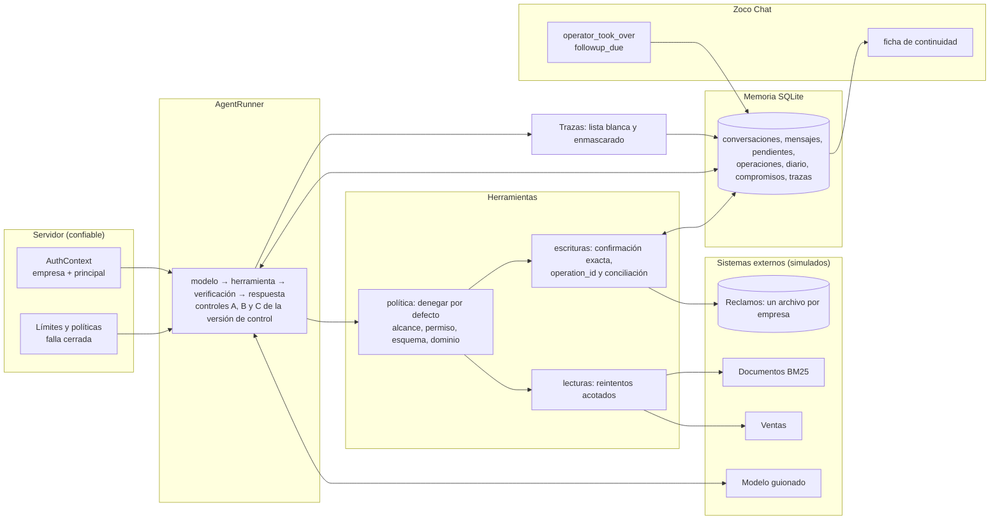

# Zoco Cortex: harness de agentes

Un motor pequeño para correr agentes con permisos, memoria, control humano y seguimiento
comercial, con cada empresa completamente separada de las demás. Es la segunda prueba técnica de
Zoco y reutiliza los componentes de la primera (ventas, reclamos, buscador, contratos de fechas).

El comando que lo prueba todo, sin claves ni internet: `make eval`.

## Empezá acá

| Querés ver... | Mirá |
|---|---|
| El motor: modelo, herramienta, verificación, respuesta | `src/cortex/runner/agent_runner.py` |
| Cómo se rechaza lo que no está permitido | `src/cortex/tools/policy.py` |
| Cómo una escritura no se duplica | `src/cortex/tools/writes.py` |
| Cómo se aíslan las empresas | `src/cortex/memory/tenant_store.py` |
| Cómo se comprueba que todo funciona | `evaluation/harness/checker.py` |
| Qué dice la consigna, qué es trampa y qué decidí | [REVISION_CONSIGNA.md](REVISION_CONSIGNA.md) |
| Por qué está hecho así, y el caso de Zoco Canchas | [DESIGN_DECISIONS.md](DESIGN_DECISIONS.md) |

## Instalación y uso

```bash
make setup    # dependencias desde uv.lock (Python 3.11 o superior)
make eval     # los 13 escenarios del kit y variantes propias, contra el estado real
make demo     # cinco escenarios (lectura, otra empresa, escritura, toma de control, seguimiento)
make check    # lint, tipos estrictos, contratos de arquitectura y tests
uv run python evaluation_adapter.py --scenario examples/T02.json --output resultado.json
```

El modelo es un guion determinista (el `model_script` de cada escenario), así que nada necesita
internet ni claves. El `.env.example` es el de la primera entrega: el harness no lee variables.
**No incluye la demostración con un LLM real** (IT no facilitó acceso): el modelo entra por el
puerto de `src/cortex/runner/model.py`, que es donde se enchufaría.

## Cómo funciona



- **El modelo propone, el código dispone.** Una solicitud de herramienta pasa por una cadena que
  deniega por defecto; un rechazo nunca llega al adaptador de la herramienta.
- **La empresa viene del servidor.** Ningún argumento del modelo ni texto del usuario la elige, y
  ningún método de memoria recibe el id de empresa: se construye desde el contexto autenticado.
- **Una escritura se ejecuta una vez.** Pide la confirmación exacta de sus valores y queda
  registrada por (empresa, `operation_id`) antes de llamar al sistema externo.
- **La versión de control se mira tres veces** (antes del modelo, antes de ejecutar y al entregar):
  una respuesta generada antes de que una persona tome el control no se envía.

## La consigna, punto por punto

| Sección | Dónde | Cómo se prueba |
|---|---|---|
| 2. Motor y límites | `src/cortex/runner/`, `src/cortex/config.py` | `tests/cortex/integration/test_kit_scenarios.py::test_t08_the_scenario_step_limit_overrides_the_default` |
| 2. Sin estado global | todo `src/cortex/` | `tests/cortex/unit/test_harness_invariants.py::test_no_module_holds_mutable_global_state` |
| 3. Permisos y alcance | `src/cortex/tools/policy.py`, `src/cortex/identity.py` | `tests/cortex/integration/test_tenancy.py::test_claiming_to_be_an_administrator_does_not_open_another_company` |
| 3. Confirmación exacta | `src/cortex/tools/confirmation.py` | `tests/cortex/integration/test_writes.py::test_changed_values_after_a_confirmation_need_a_new_one` |
| 4. Persistencia y reinicio | `src/cortex/memory/` | `tests/cortex/integration/test_chat.py::test_three_separate_processes_file_one_claim` |
| 4. Historial acotado | `src/cortex/runner/agent_runner.py` | `tests/cortex/integration/test_runner.py::test_the_history_sent_to_the_model_is_bounded_but_critical_state_is_not_summarized` |
| 4. Dos empresas, mismo nombre | `src/cortex/memory/tenant_store.py` | `tests/cortex/integration/test_tenancy.py::test_t06_interleaved_conversations_of_two_companies_stay_separated` |
| 5. Reintentos y fallas | `src/cortex/tools/retry.py`, `src/cortex/tools/failures.py` | `tests/cortex/integration/test_failures.py::test_t07_a_transient_read_failure_is_retried_once_and_counted_once` |
| 5. Escritura incierta | `src/cortex/tools/writes.py` | `tests/cortex/integration/test_writes.py::test_a_write_committed_before_a_timeout_is_reconciled_not_repeated` |
| 6. Toma de control | `src/cortex/chat/service.py` | `tests/cortex/integration/test_chat.py::test_t11_a_reply_generated_before_the_takeover_is_never_delivered` |
| 6. Seguimiento | `src/cortex/chat/followup.py` | `tests/cortex/unit/test_followup.py::test_each_case_of_the_kit` |
| 7. Trazas sin secretos | `src/cortex/observability/` | `tests/cortex/integration/test_traces.py::test_no_secret_reaches_a_trace_a_result_a_log_or_the_operators_card` |
| 7. Evaluación sobre estado real | `evaluation/harness/` | `tests/cortex/integration/test_eval_suite.py::test_an_adapter_that_reports_a_message_that_was_not_sent_is_caught` |

## Las tres condiciones críticas

La consigna descarta una entrega que permita alguna de estas tres cosas.

| Condición | Cómo se impide | Prueba |
|---|---|---|
| Acceso entre empresas | La empresa sale del contexto autenticado; los repositorios están atados a ella; cada consulta SQL filtra por empresa | `tests/cortex/integration/test_tenancy.py::test_every_query_on_company_data_filters_by_company` |
| Herramienta o escritura no autorizada | Cadena que deniega por defecto; las escrituras exigen confirmación exacta | `tests/cortex/unit/test_policy.py::test_naming_a_company_or_a_role_is_a_scope_violation_that_ends_the_run` |
| Escritura duplicada al reintentar | Registro por (empresa, `operation_id`), clave única en el sistema de reclamos y conciliación antes de reintentar | `tests/cortex/integration/test_writes.py::test_concurrent_executions_of_one_command_have_one_effect` |

## Resultados y trazas

- Resultados fechados, con el commit evaluado: `evaluation/results/harness/2026-10-30/report.md`.
- Dos trazas anonimizadas, un éxito y un fallo: `evaluation/results/harness/traces/`
  (se regeneran con `python -m cortex.kit_adapter.samples`).
- El verificador no importa el harness: recalcula los efectos leyendo los archivos SQLite en solo
  lectura, así que un adaptador que informe algo distinto de lo que hay en la base falla.

## Revisión adversarial

Antes de entregar, dos revisores ciegos e independientes (dos agentes con el mismo encargo, sin
ver el trabajo del otro) buscaron formas de violar las tres condiciones críticas. Coincidieron en
un defecto crítico: una escritura con resultado incierto se volvía a enviar sin revisar la
confirmación, así que después de una toma de control podía crear un reclamo que nadie había
confirmado de nuevo. También coincidieron en cinco advertencias: carreras entre el control y la
escritura, una operación que podía quedar trabada, un reintento tras un crash que podía repetir
una respuesta, la ficha del operador y un código de salida. Todo se corrigió, y cada hallazgo
tiene un test que falla con el código revisado y pasa ahora:
`tests/cortex/integration/test_review_findings.py`.

Una segunda pasada no encontró ningún defecto crítico. También se corrigieron sus cinco hallazgos
menores (un `run_id` derivado que desbordaba el largo permitido, una conversación ajena que podía
conciliar un comando incierto, una confirmación ya usada que se reutilizaba tras un fallo, la
repetición de un seguimiento con otra conversación o carrera, y un valor que podía imitar otro
campo en la pregunta de confirmación), con sus tests en el mismo archivo.

## Limitaciones pendientes

- **Sin demostración con LLM real** (ver arriba).
- **Los hilos abandonados por un timeout no se pueden matar** (Python no lo permite): una llamada
  lenta puede terminar en segundo plano. Por eso todo timeout de una escritura se trata como
  incierto y se verifica por su `operation_id`; una lectura abandonada se descarta.
- **Un comando interrumpido por un crash no se vuelve a ejecutar con el mismo `run_id`** (podría
  haber respondido antes de caerse): termina `FAILED` con `run_interrupted` y se reintenta con un
  `run_id` nuevo. Una escritura que quedó en vuelo se concilia por su `operation_id`.
- **Sin migraciones de esquema.** Cada mundo se crea con el esquema vigente; un `--workdir` que
  quedó de una versión anterior hay que borrarlo antes de reutilizarlo.
- **Autenticación simulada.** El principal y la empresa son fixtures confiables del evaluador;
  no hay login, emisión ni vencimiento de credenciales.
- **Un solo proceso y SQLite local.** Los candados (una ejecución por conversación, escrituras con
  `BEGIN IMMEDIATE`) están probados con hilos y con procesos secuenciales, no con varios servidores.
- **Los mensajes se guardan completos** en la tabla de la conversación (es la memoria); las
  trazas, los resultados, los logs y la ficha del operador no los llevan, pero no hay política de
  retención ni de borrado.
- **La sal del hash del principal en las trazas es pública** en esta demostración.
- **No se integra el modo SUGGEST** (borradores que aprueba un operador) de la primera entrega: una
  conversación que no está en AUTO no ejecuta al agente.
- **El seguimiento registra la decisión, no la ejecuta**: no hay scheduler ni envío (la consigna
  los excluye).
- **Búsqueda solo léxica** (BM25). Heredada: para "devoluciones" el documento de liquidaciones
  puntúa antes que el de cancelaciones, porque este último no usa esa palabra en el cuerpo.
- **Algunas variantes de IT no entran en un proceso único** (el mismo `run_id` dos veces, el
  documento envenenado, el historial largo): las cubren tests de integración, no `make eval`.

## Uso de asistentes de IA

Este proyecto se hizo con Claude Code (modelos Claude Opus 5.5 y Sonnet 5.5). El asistente
escribió la mayor parte del código, de los tests y de los documentos, y también el análisis de la
consigna (trampas y contradicciones) leyendo los archivos del kit. Se trabajó con un plan
aprobado antes de empezar y por bloques de trabajo, y cada bloque se aprobó antes de pasar al
siguiente. La persona que entrega eligió el alcance, la arquitectura entre las alternativas
propuestas y el modelo y esfuerzo de cada bloque (Opus para la lógica con invariantes de
seguridad; Sonnet para el resto).

Nada se da por bueno porque el asistente lo diga: lo comprueban los tests, los contratos de
arquitectura y la evaluación contra el estado real (`make check` y `make eval`).

## Primera entrega

El buscador, el agente, la máquina de estados y su evaluación siguen intactos, con la etiqueta
`prueba-1` y su documentación en [PRUEBA_1.md](PRUEBA_1.md).
