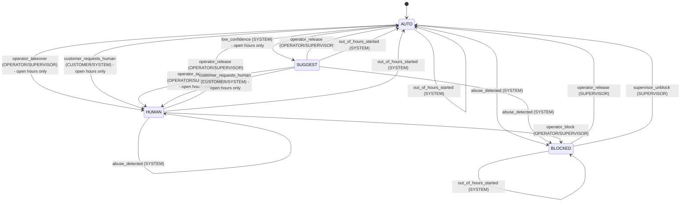

# Diagrama de estados IA-humano

Generado por `make diagram` a partir de la tabla de reglas de `src/merchant_assistant/control/rules.py`. No se edita a mano: un test falla si este archivo no coincide con el código.

- `[*] --> AUTO`: toda conversación empieza en AUTO.
- Cada flecha dice `evento (actores que pueden dispararlo)`.
- Una flecha que termina en `- open hours only` solo se permite dentro de la franja de atención humana; fuera de ella el evento se rechaza con el código `out_of_hours`.
- Cualquier par (estado, evento) que no figure como flecha es indefinido y falla con `invalid_transition`.

## Efectos que la aplicación debe ejecutar

Son instrucciones declarativas: el dominio las devuelve y no las ejecuta.

| Efecto | Cuándo | Qué hace |
|---|---|---|
| `invalidate_pending_action` | Todo cambio de estado | Descarta la acción pendiente (por ejemplo, un reclamo a medio confirmar). |
| `discard_unapproved_drafts` | Al salir de SUGGEST | Descarta los borradores que nadie aprobó, para que no se envíen después. |
| `notify_operator` | Abuso detectado en HUMAN | Avisa al operador, que decide si bloquea (`operator_block`). El estado no cambia. |
